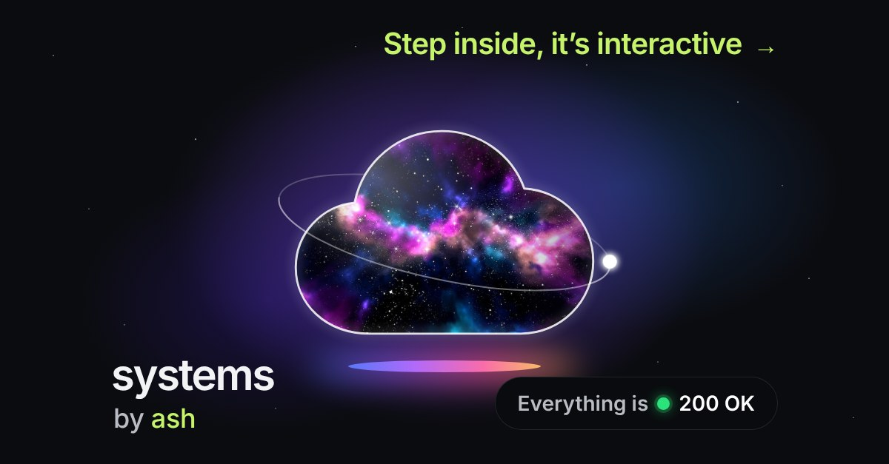

  

<h3 align="center">👋 Hi, I'm Ashley</h3>

Solutions Architect at ShipBob · ex-IBM I create AI tools and products, and ship them until real people use them.

  <a href="https://systemsbyash.com/card/gh"><b>🎮 Play my portfolio →</b></a>

---

**What I've built**

- ⚡ **8+ AI agents** that cut integration troubleshooting **45%**
- ⏱️ Rate uploads went from **5+ weeks to ~15 minutes**
- 🌍 **500K+ shipping routes** moved to new carriers across Asia and Europe in about a week, zero downtime
- 🐍 **~$500K a year** saved with 150+ Python automations

**Inside the portfolio:** 4 interactive case studies, 3 arcade games built from real days at work, and an AI you can ask about my work.

**Works with:** REST APIs · Paragon · Python · Claude Skills · MCP · Cloudflare Workers · Snowflake · Power BI
